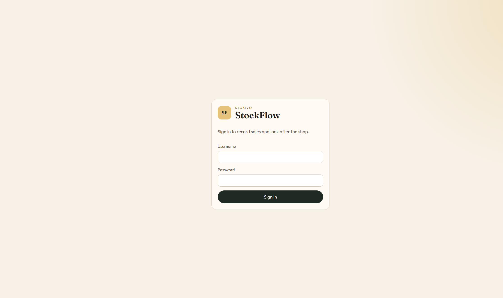
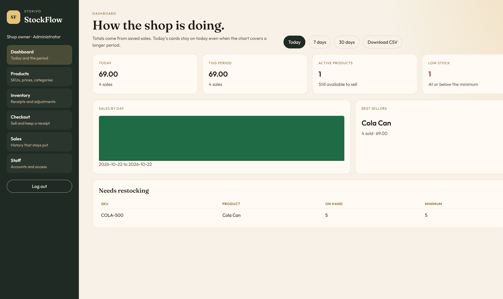
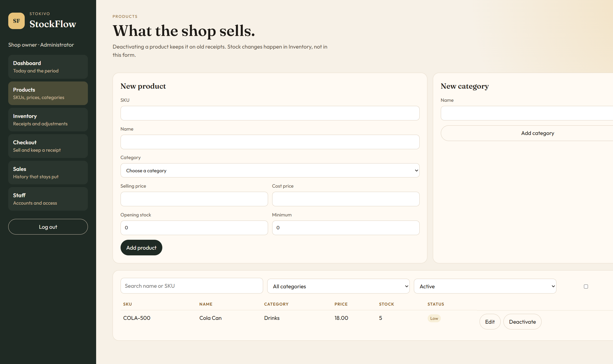
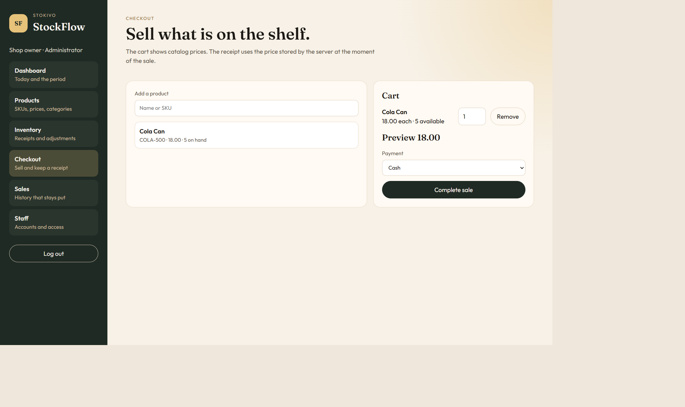

# StockFlow

StockFlow is a small-shop inventory and sales app. Staff sign in, sell what is on the shelf, and the receipt keeps the price that was charged. Administrators look after products, stock, staff accounts, and the day's totals.

The API is Spring Boot. The shop screens are React. PostgreSQL stores products, stock movements, and sales.









The pictures are from a shop that already has stock and sales. A fresh database starts empty.

## What it does

- Products have a unique SKU, a category, a selling price, a cost price, and a minimum stock level. Deactivating a product keeps it on old receipts.
- Stock changes are receipts or adjustments, each with a reason. A sale deducts stock in the same transaction as the receipt. Stock cannot go below zero.
- Checkout sends the product and the quantity. The server stores the selling price at that moment and ignores any price sent by the browser.
- The dashboard shows today's total, a period chart, best sellers, and products that need restocking. Administrators can download the period as CSV.

## Roles

An **administrator** manages products, categories, receipts, adjustments, every sale, the dashboard, and staff accounts.

**Staff** can look up products, check out, and see only the sales they completed. They cannot change prices, receive or adjust stock, see cost prices, open the dashboard, or manage accounts. Those limits are enforced on the API.

## Run it locally

You need Java 17 or newer, Maven, Node.js, and PostgreSQL 15 or newer.

Create a database the API can own. From `psql` as a superuser:

```sql
CREATE USER helpdesk WITH PASSWORD 'helpdesk';
CREATE DATABASE stockflow_app OWNER helpdesk;
\c stockflow_app
GRANT CREATE ON SCHEMA public TO helpdesk;
```

Use another username and password if you prefer, and set the matching environment variables below. The API creates its tables on startup.

In one terminal, from `backend`:

```powershell
mvn spring-boot:run
```

The API listens on [http://localhost:8080](http://localhost:8080). `GET /api/health` does not require a sign-in.

In another terminal, from `frontend`:

```powershell
npm install
npm run dev
```

Open [http://localhost:5173](http://localhost:5173). The dev server sends `/api` requests to port 8080.

The first start, when the users table is empty, creates one administrator:

| | |
|---|---|
| Username | `admin` |
| Password | `stockflow` |

A later restart does not reset that password. Create staff accounts from the Staff screen after you sign in.

## Configuration

Defaults live in `backend/src/main/resources/application.yaml`. Override them with environment variables before you start the API.

| Variable | Default | Purpose |
|---|---|---|
| `STOCKFLOW_DB_URL` | `jdbc:postgresql://localhost:5432/stockflow_app` | Database |
| `STOCKFLOW_DB_USERNAME` | `helpdesk` | Database user |
| `STOCKFLOW_DB_PASSWORD` | `helpdesk` | Database password |
| `STOCKFLOW_JWT_SECRET` | a development signing key | Must be at least 32 bytes |
| `STOCKFLOW_ADMIN_USERNAME` | `admin` | First administrator, only when no users exist |
| `STOCKFLOW_ADMIN_PASSWORD` | `stockflow` | First administrator password |

Set `STOCKFLOW_JWT_SECRET` and `STOCKFLOW_ADMIN_PASSWORD` before the first start if anyone else will be able to reach the app. The administrator password is saved on that first start. The development defaults are in the repository.

## Tests

From `backend`:

```powershell
mvn test
```

Tests use an embedded PostgreSQL and do not touch `stockflow_app`.

## Out of scope

Online payments, suppliers, more than one branch, barcode hardware, loyalty, and a mobile app are not part of this project.
